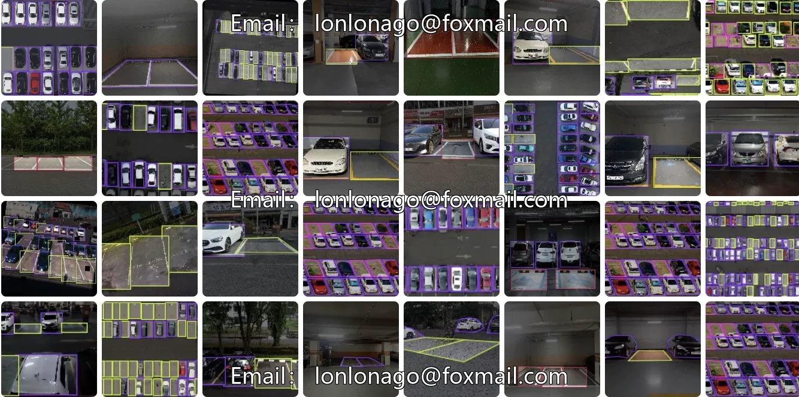
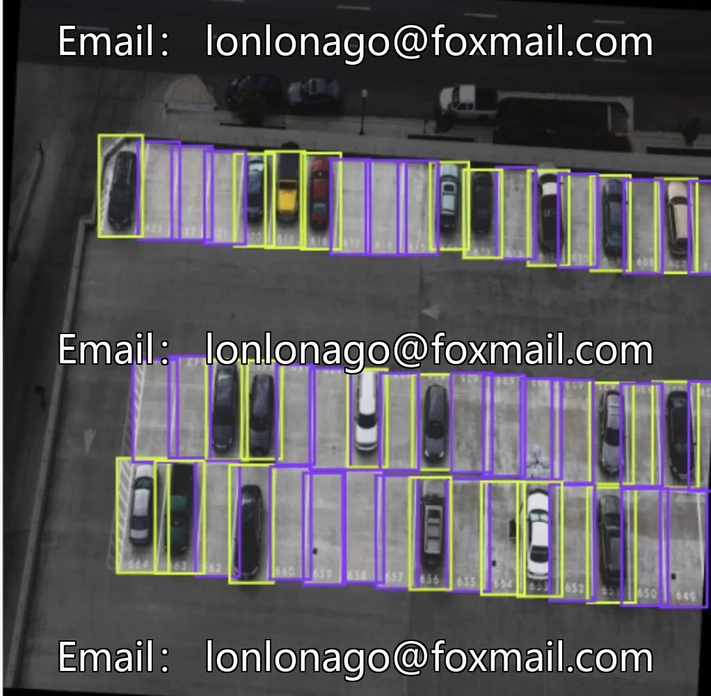
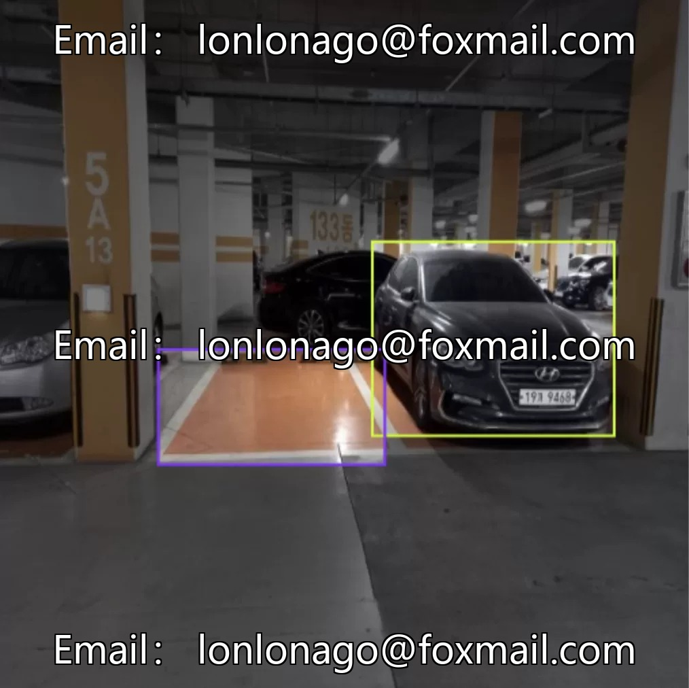
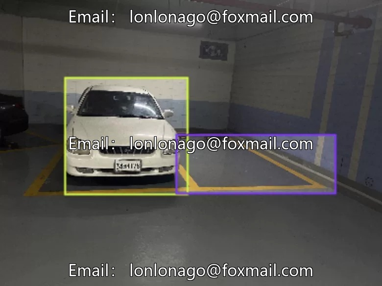
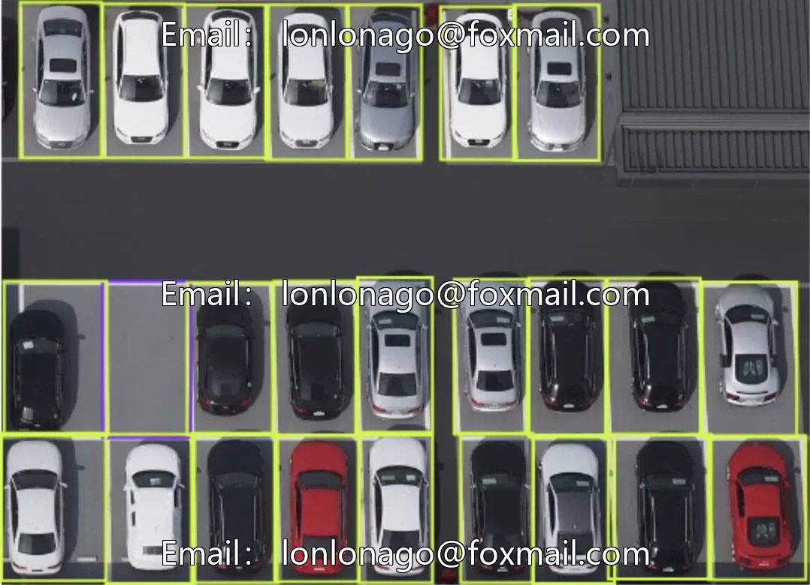
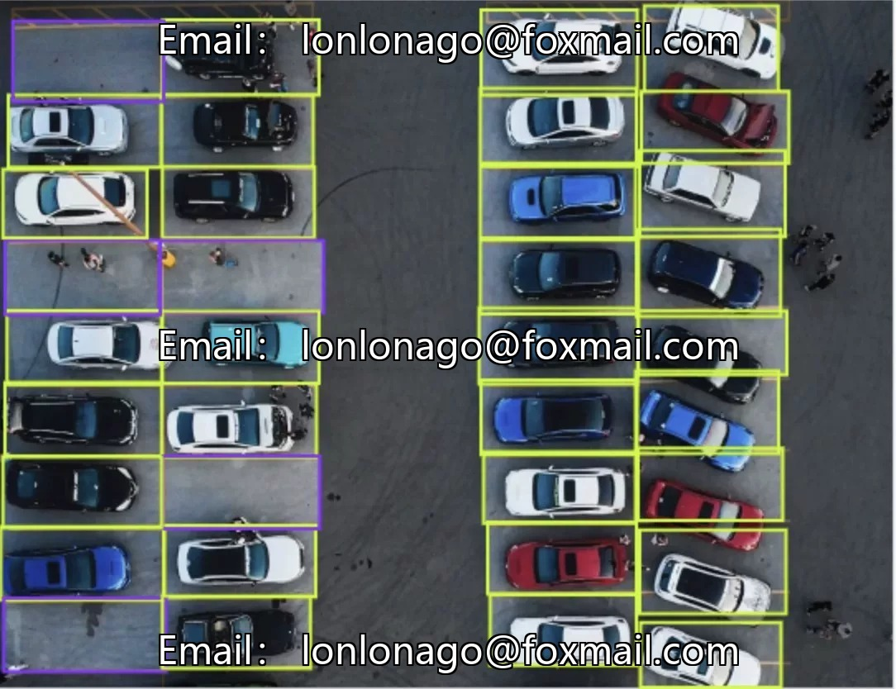

# Drone aerial photography inspection and parking lot spot recognition dataset

## Body

Drone aerial photography inspection dataset for open parking lot vehicle and free space identification
Contains 913 images, with the core categories being "car" (vehicle) and "free" (idle parking space), suitable for real-time monitoring of parking lot spaces, guidance for idle spaces, and enhancing operational efficiency in target detection tasks.
The dataset is primarily composed of images, accompanied by one dataset file and one trained target detection model. It supports uploading image files to test the model's effectiveness. The data volume is sufficient to avoid underfitting due to insufficient samples, and the accompanying model can be directly used, reducing development costs.
Virtual materials, once sold, are not available for refund.
Interested friends, click "I want it" now!

## Images

## Payment

Here is a pay link on Stripe ( https://buy.stripe.com/3cs8yP7sY87d0vu9AB ). Please contact me lonlonago@foxmail.com after funding $89, and I will send you a complete data files , thank you!

